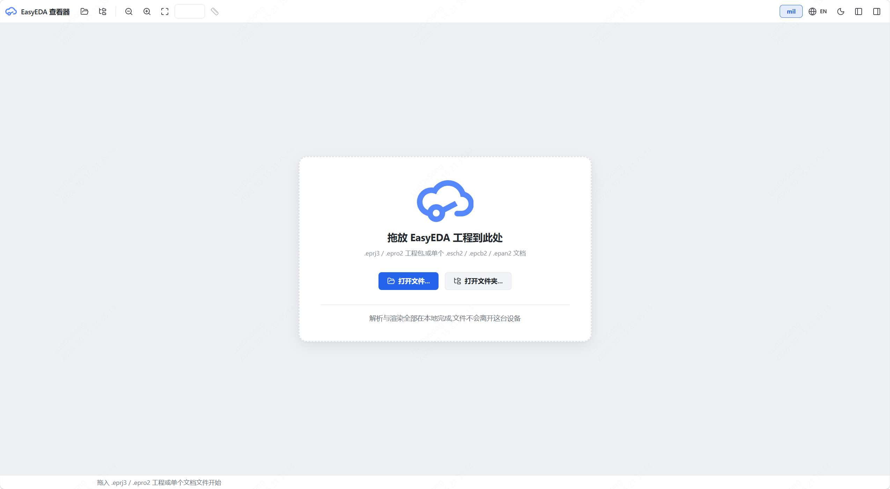
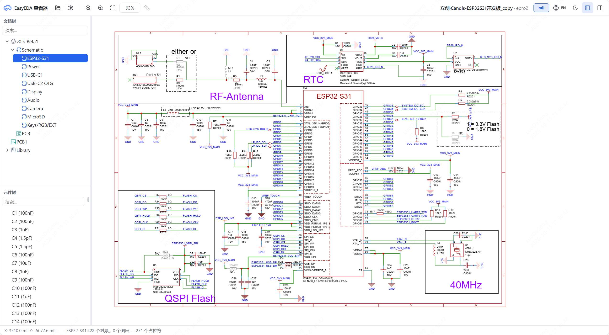
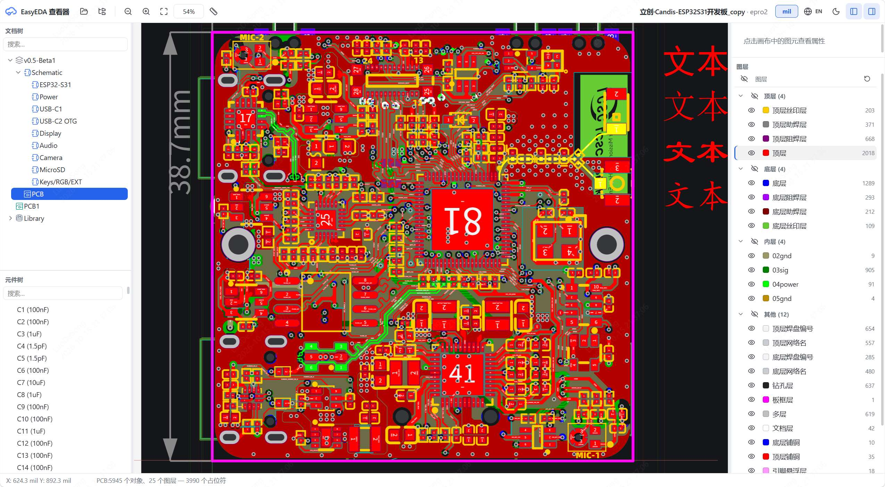
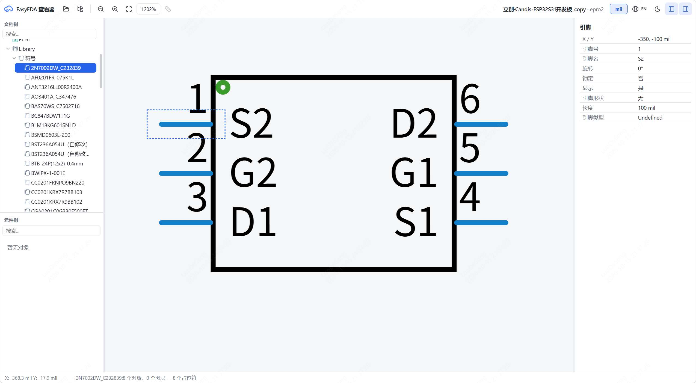

# easyeda-viewer

[English](#english) · **简体中文**

---

## English

**English** | [简体中文](#简体中文)

A lightweight, offline, embeddable viewer for **EasyEDA Pro** (嘉立创EDA专业版) projects. Parsing and rendering run entirely in the browser — nothing is uploaded and no server is required. The whole viewer is a single HTML file: open it and drop a project in.

> Read-only viewer: no schematic/PCB editing, saving, DRC/ERC, BOM, 3D view or Gerber export. Annotations are kept as separate data and never written back to the project files.

**Download:** [Latest release](https://github.com/easyeda/easyeda-viewer/releases/latest) · **Docs:** [Integration API](docs/easyeda-viewer-api.md) · [Development guide](docs/development.md) · [Architecture](docs/ARCHITECTURE.md) · [Changelog](CHANGELOG.md)

### Highlights

- **Fully local** — projects are parsed and rendered in memory; no network, no upload.
- **Single-file build** — one `dist/index.html` with all JS/CSS inlined; open it directly or embed it in an iframe.
- **Schematics, PCBs, panels, symbols and footprints** — project tree, object tree, properties panel and layer panel, with two-way selection between tree and canvas.
- **Visual fidelity** — pixel-level regression against official client exports (sheet frames, title blocks, power symbols, net labels, PCB strokes, pour/drill stacking).
- **Annotations** — text, rectangle and circle annotations with replies, status, editing and visibility; imported/exported through the JS API.
- **Windows desktop app** — install-free exe (Go + WebView2) with native file dialogs and drag-and-drop; a separate build keeps Windows 7 support.
- **Bilingual UI** — Chinese / English interface, light / dark themes.

### Screenshots

| Welcome | Schematic |
| --- | --- |
|  |  |
| **PCB** | **Library / Footprint** |
|  |  |

### Supported formats

| Format | Description |
| --- | --- |
| `.eprj3` (folder) | EasyEDA Pro folder project: `*.eprj3` index + `sch/`, `pcb/`, `panel/` |
| `.zip` | An `.eprj3` project folder packed as a ZIP (unzipped automatically) |
| `.epro2` | Single-file project (ZIP container), including reuse-block / CBB projects |
| `.esch2` / `.epcb2` / `.epan2` / `.esym2` | Single schematic page / PCB / panel / symbol document |
| `.elibz2` | EasyEDA Pro library archive — preview its symbols and footprints |
| `.epru` | Project record stream (usually inside `.epro2`) |

### How to use

**Windows desktop app** — download the exe and open a project with the native dialog or by dragging it in:

| Build | System | Notes |
| --- | --- | --- |
| `easyeda-viewer_v*.exe` | Windows 10 / 11 | Requires the Evergreen WebView2 runtime |
| `easyeda-viewer_win7_v*.exe` | Windows 7 SP1 x64 / 10 / 11 | Requires the Universal C Runtime (KB2999226) and **WebView2 109** (the last version supporting Win7) |

**Browser** — open `dist/index.html` in Chrome / Edge / Firefox and drag an `.eprj3` folder, `.epro2`, `.zip`, `.elibz2` or a single document onto the canvas. On Windows 7 without WebView2, use Chrome 109 or Firefox 115 ESR.

**Viewer basics**

- **Project tree** (upper-left): project → board → schematics / PCB / panel / simulation; searchable, arrow keys open documents.
- **Object tree** (lower-left): primitives grouped by type, searchable, with visibility toggles.
- **Properties & layers** (right): attributes of the selected primitive; layer list with eye toggles for PCB, panel and footprint documents.
- **Canvas**: wheel zoom at the pointer, pan with right/middle drag or space + left drag, click to select.
- **Customize**: switch theme and language from the toolbar; panels can be resized or hidden.

### Known issues

- Default text may differ slightly from the EDA client: the client draws its default font as vector paths that are not stored in the project file, so a substitute font is used.

### Roadmap

- [ ] Hierarchical schematics
- [ ] Net tree
- [ ] PCB rendering engine replacement and performance work

### License

[Apache License 2.0](LICENSE)

---

## 简体中文

[English](#english) | **简体中文**

一款轻量、离线、可嵌入的 **嘉立创EDA专业版 / EasyEDA Pro** 工程查看器。解析与渲染全部在浏览器本地完成，无需上传文件、无需安装服务端；整个查看器就是一个 HTML 文件，双击即可使用。

> 只读查看器：不支持原理图 / PCB 编辑、保存、DRC/ERC、BOM、3D 视图与 Gerber 导出。批注是独立数据，不会写回工程文件。

**下载：**[最新版本](https://github.com/easyeda/easyeda-viewer/releases/latest) · **文档：**[集成 API](docs/easyeda-viewer-api.md) · [开发指南](docs/development.md) · [技术架构](docs/ARCHITECTURE.md) · [更新日志](CHANGELOG.md)

### 核心特性

- **纯本地** —— 工程在内存中解析和渲染，不联网、不上传。
- **单文件产物** —— `dist/index.html` 内联全部 JS/CSS，可双击打开或 iframe 嵌入。
- **原理图 / PCB / 面板 / 符号 / 封装预览** —— 文档树、对象树、属性面板与图层面板，树与画布双向定位。
- **视觉保真** —— 以官方客户端导出截图为基准做像素级对照（图框、标题栏、电源符号、网络标签、PCB 描边、铺铜与钻孔层序）。
- **工程批注** —— 文字、矩形框、圆形框批注，支持回复、状态、编辑与显隐，通过 JS API 导入导出。
- **Windows 桌面版** —— 免安装 exe（Go + WebView2），支持原生文件对话框与拖放打开；另提供保留 Windows 7 支持的版本。
- **中英双语界面** —— 中文 / English 切换，深色 / 浅色主题。

> 界面截图见上方 [Screenshots](#screenshots)。

### 支持格式

| 格式 | 说明 |
| --- | --- |
| `.eprj3`（文件夹） | 专业版文件夹工程：`*.eprj3` 索引 + `sch/`、`pcb/`、`panel/` |
| `.zip` | 将 `.eprj3` 工程文件夹打包后的 ZIP，自动解压识别 |
| `.epro2` | 单文件工程（ZIP 容器），含复用块 / CBB 工程 |
| `.esch2` / `.epcb2` / `.epan2` / `.esym2` | 单个原理图页 / PCB / 面板 / 符号文档 |
| `.elibz2` | 专业版库包，可预览其中的符号与封装 |
| `.epru` | 工程记录流（常见于 `.epro2` 内部） |

### 使用方式

**Windows 桌面版** —— 下载 exe 后，用原生对话框选择工程或直接把文件 / 文件夹拖进窗口：

| 版本 | 适用系统 | 说明 |
| --- | --- | --- |
| `easyeda-viewer_v*.exe` | Windows 10 / 11 | 需要 Evergreen WebView2 运行时 |
| `easyeda-viewer_win7_v*.exe` | Windows 7 SP1 x64 / 10 / 11 | 需要通用 C 运行时（KB2999226）与 **WebView2 109**（最后一个支持 Win7 的版本） |

**浏览器** —— 用 Chrome / Edge / Firefox 打开 `dist/index.html`，把 `.eprj3` 文件夹、`.epro2`、`.zip`、`.elibz2` 或单个文档拖入画布即可。Windows 7 无 WebView2 时，请使用 Chrome 109 或 Firefox 115 ESR。

**界面操作**

- **文档树**（左上）：工程 → Board → 原理图 / PCB / 面板 / 仿真，可搜索，方向键上下切换并打开文档。
- **对象树**（左下）：按图元类型分组，可搜索，带显隐开关。
- **属性与图层**（右侧）：显示选中图元的属性；PCB / 面板 / 封装文档底部列出图层，带眼睛开关。
- **画布**：滚轮以指针为中心缩放；右键 / 中键 / 空格 + 左键拖拽平移；左键点选。
- **个性化**：工具栏切换主题与语言；面板可拖拽调整或隐藏。

### 已知问题

- 默认字体与 EDA 客户端略有差异：客户端的默认字体是自绘路径，未存入工程文件，查看器只能使用替代字体。

### 路线图

- [ ] 层次图
- [ ] 网络树
- [ ] PCB 渲染引擎替换与性能优化

### 许可证

[Apache License 2.0](LICENSE)
