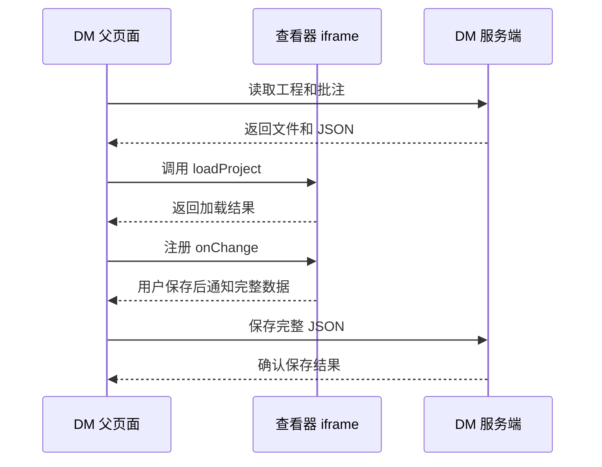

# 批注查看器：DM 接入说明

适用文件：本项目执行 `npm run build` 后生成的 `dist/index.html`。
该产物已内置批注功能，不需要额外注入脚本。
原外发文件 `easyeda-viewer_0.4.2_annotations.html` 使用相同的批注数据格式和接口版本。
接口版本：`easyedaViewer.version === '1.1.0'`。
数据版本：`schemaVersion === 1`。
实现位于 `src/ui/annotations.js`，接口类型位于 `src/ui/annotations.d.ts`。
文字采用短句和固定术语。

源码集成时，`createViewer(host)` 返回的 `viewer.annotations` 提供同一套批注 API。
只有独立页面入口会将它公开为 `window.easyedaViewer`。
调用 `viewer.destroy()` 时会清理批注监听和观察器。
批注界面目前使用中文，原查看器的语言切换不会翻译批注文案。

## 1. 先明确职责

查看器负责显示工程和编辑批注。
DM 负责加载文件、提供用户信息和保存数据。

查看器不会自动发送 HTTP 请求。
查看器不会把批注写回工程。
查看器不会自动持久保存批注。
关闭或刷新页面会丢失未保存的数据。



从 DM 读取工程开始。只有服务端确认后，DM 才能显示“已保存”。

## 2. 部署条件

1. 将 HTML 放到 DM 可访问的地址。
2. 让 iframe 与 DM 使用相同的协议、域名和端口。
3. 等待 iframe 的 `load` 事件。
4. 读取 `iframe.contentWindow.easyedaViewer`。
5. 检查 `api.version`。

跨域 iframe 不能直接调用此 JS API。
本版没有提供跨域批注 `postMessage` 协议。
原查看器已有的消息入口不等于批注接口。

DM 必须检查 CSP 和 iframe 策略。
HTML 使用内嵌脚本与内嵌样式。
限制这些内容的 CSP 会阻止查看器运行。
移除 iframe 源身份的 sandbox 配置会阻止父页面直接访问 API。
请由 DM 安全负责人确认部署策略。

不要依赖 `window.__ev`。它是内部调试对象。
本说明只约定 `window.easyedaViewer`。

## 3. 准备工程文件

推荐使用完整的 `.eprj3` 工程目录。
目录必须包含工程描述和配套图纸。
不能只传一个 `.eprj3` 文件。

支持两种输入：

| 输入 | 用法 |
| --- | --- |
| `FileList` | 浏览器目录选择控件返回的文件列表 |
| `File[]` | DM 下载文件后构造的文件数组 |

```html
<input id="projectFiles" type="file" webkitdirectory multiple>
```

```js
const files = document.querySelector('#projectFiles').files;
```

DM 从服务端下载时，保留相对路径：

```js
// entries 由 DM 提供。每项包含 relativePath 和 downloadUrl。
const files = [];
for (const entry of entries) {
  const response = await fetch(entry.downloadUrl);
  if (!response.ok) throw new Error(`下载失败：${response.status}`);
  files.push(new File([await response.blob()], entry.relativePath));
}
```

例如：`project.eprj3`、`sch/Schematic1/P1.esch2`、`pcb/PCB1.epcb2`。
`webkitRelativePath` 非空时，查看器优先使用该路径。
否则，查看器使用 `File.name`。
同一次加载只传一个工程。

原查看器也支持部分 `.epro2`、ZIP 和单文档输入。
本批注版不新增工程格式解析器。
SQLite 格式的 `.eprj2` 不受支持。
不要通过修改后缀来转换格式。

图纸必须登记在工程描述中。
目录中存在 PCB 文件，不代表工程树一定显示它。
加载后检查 `getContext().documents`。

## 4. 最小接入步骤

1. 先准备工程文件。
2. 读取 DM 已保存的批注。
3. 创建 iframe 并等待加载。
4. 调用 `loadProject` 并等待完成。
5. 检查文档列表和当前图纸。
6. 注册 `onChange`。
7. 将变更数据交给 DM 保存队列。

```js
async function createViewer(container, files, savedData) {
  const iframe = document.createElement('iframe');
  iframe.title = '工程查看器';
  iframe.style.cssText = 'width:100%;height:800px;border:0';
  const loaded = new Promise((resolve, reject) => {
    iframe.addEventListener('load', resolve, { once: true });
    iframe.addEventListener('error', reject, { once: true });
  });
  iframe.src = '/viewer/easyeda-viewer_0.4.2_annotations.html';
  container.append(iframe);
  await loaded;

  const api = iframe.contentWindow.easyedaViewer;
  if (!api || api.version !== '1.1.0') {
    throw new Error('查看器 API 不可用或版本不匹配');
  }
  const options = {
    projectId: 'DM-001',
    revision: 'R1',
    user: { id: 'user-123', name: '审核者' }
  };
  if (savedData !== null && savedData !== undefined) {
    options.annotations = savedData;
  }
  await api.loadProject(files, options);

  const context = api.getContext();
  if (!context.documents.length || !context.currentDocument) {
    throw new Error('工程没有可批注的当前图纸');
  }
  return { iframe, api };
}
```

此示例中的 URL、工程 ID 和用户信息需要由 DM 替换。
没有旧数据时，省略 `annotations`。
不要传 `null`。`null` 会被当作无效导入数据。

在加载后注册回调，可避免把初次恢复当成用户修改。
如果提前注册，DM 需要自行屏蔽恢复阶段的 `import` 通知。

## 5. 完整接口表

除标记为异步的方法外，其他方法都是同步方法。
同步方法可能抛出异常。
异步方法需要 `await` 和错误处理。

| 接口 | 输入 | 返回值 | 作用 |
| --- | --- | --- | --- |
| `version` | 无 | 字符串 `1.1.0` | 读取接口版本 |
| `loadProject(files, options)` | 文件列表、加载选项 | `Promise<Snapshot>` | 加载工程，可恢复批注 |
| `getContext()` | 无 | `Context` | 读取工程和当前图纸 |
| `setUser(user)` | `{id, name}` | 用户对象副本 | 设置后续新增和回复的作者 |
| `exportAnnotations()` | 无 | `Snapshot` | 读取全部已提交批注的副本 |
| `importAnnotations(data)` | `Snapshot` 或 JSON 字符串 | 导入的批注数量 | 验证后全量覆盖 |
| `createAnnotation(input)` | 类型、坐标、文字、可选图纸 ID | 新批注副本 | 新增批注 |
| `updateAnnotation(id, patch)` | 批注 ID、`text` 或 `status` | 更新后的批注副本 | 修改文字或状态 |
| `deleteAnnotation(id)` | 批注 ID | `undefined` | 删除批注及其全部回复 |
| `addReply(id, content)` | 批注 ID、回复字符串 | 新回复副本 | 添加回复 |
| `focusAnnotation(id)` | 批注 ID | `Promise<void>` | 切到所属图纸并居中定位 |
| `open(nodeId)` | 当前文档的节点 ID | `Promise<Context>` | 打开指定图纸 |
| `undo()` | 无 | 布尔值 | 撤销成功为 `true`，无记录为 `false` |
| `redo()` | 无 | 布尔值 | 重做成功为 `true`，无记录为 `false` |
| `onChange(callback)` | 同步回调函数 | 取消订阅函数 | 监听完整数据变更 |
| `setAnnotationsVisible(value)` | 严格布尔值 | 设置后的布尔值 | 显示或隐藏全部批注标记 |
| `getAnnotationsVisible()` | 无 | 布尔值 | 读取标记显示状态 |
| `fit()` | 无 | `undefined` | 将当前图纸适配画布 |
| `setTheme(theme)` | `light` 或 `dark` | `undefined` | 设置查看器主题 |
| `setChrome(flags)` | 可选布尔字段 | `undefined` | 设置查看器区域可见性 |

`setChrome` 的字段是 `toolbar`、`left`、`right`、`status`。
这些字段控制工具栏、左栏、右栏和状态栏。
部分 UI 操作会重新打开右栏。例如定位批注。
`setChrome` 不是权限控制接口。

```js
api.setChrome({ toolbar: true, left: true, right: true, status: true });
api.setTheme('dark');
api.fit();
```

`window.easyedaViewer` 没有公开 `destroy()`。
卸载前停止订阅并等待 DM 保存队列完成。
随后移除 iframe。
不要在同一个 window 中重复执行初始化脚本。

### 5.1 加载选项

| 字段 | 类型 | 默认行为 | DM 建议 |
| --- | --- | --- | --- |
| `projectId` | 非空字符串，最多 500 字符 | 生成本地标识 | 始终传 DM 稳定工程 ID |
| `revision` | 字符串，最多 200 字符 | 空字符串 | 始终传 DM 工程版本 |
| `user` | `{id, name}` | 保留当前用户 | 每次加载都传当前登录用户 |
| `annotations` | 对象或 JSON 字符串 | 不恢复，批注为空 | 有旧数据时才传 |

首次用户默认是 `{id: 'local', name: '本地用户'}`。
省略 `user` 不会自动清除上一个工程的用户。

新工程加载会清空旧批注、选中态和撤销记录。
加载前，DM 必须保存旧工程数据。
并发调用 `loadProject` 会被拒绝。
不要并发调用加载、切图和批注修改。

`loadProject` 返回 `Snapshot`，不是 `Context`。
读取当前图纸时，另调 `getContext()`。

### 5.2 新增与修改示例

```js
const doc = api.getContext().currentDocument;
if (!doc) throw new Error('请先打开原理图或 PCB');

const item = api.createAnnotation({
  documentId: doc.id,
  type: 'rectangle',
  geometry: { x: 100, y: 200, width: 80, height: 40 },
  text: '请检查此区域'
});
api.addReply(item.id, '已安排检查');
api.updateAnnotation(item.id, { status: 'resolved' });
await api.focusAnnotation(item.id);
```

`documentId` 省略时，使用当前图纸。
新增批注默认状态是 `pending`。
作者取自当前用户。
时间取自浏览器时钟。

`updateAnnotation` 只接受 `text` 和 `status`。
传入 `geometry` 会报错。
该限制适用于公开 API。

UI 中点击“编辑”后，可以拖动对应批注。
拖动只修改草稿，大小不变。
点击“保存”后，文字和位置一起提交。
点击“取消”后，位置恢复。
非编辑状态不能移动或缩放批注。

不提供单独修改或删除回复的 API。
删除批注会删除全部回复。

## 6. 数据结构

### 6.1 Snapshot

`Snapshot` 是当前工程全部批注的完整数据。
它不是单条变更数据。

| 字段 | 类型 | 含义 |
| --- | --- | --- |
| `schemaVersion` | 数字 | 当前固定为 `1` |
| `projectId` | 字符串 | DM 工程 ID |
| `revision` | 字符串 | DM 工程版本 |
| `documents` | `Document[]` | 当前工程可批注图纸列表 |
| `annotations` | `Annotation[]` | 所有图纸的已提交批注 |

`exportAnnotations()` 返回独立副本。
修改副本不会修改查看器内部数据。
导出不包含未保存的编辑草稿。

### 6.2 Document 与 Context

| Document 字段 | 含义 |
| --- | --- |
| `id` | 稳定图纸标识，当前格式为分组加图纸 UUID |
| `nodeId` | 当前工程树节点 ID，供 `open()` 使用 |
| `group` | `schematic` 或 `pcb` |
| `title` | 图纸名称 |

使用返回的 `id`，不要自行拼接。
将 `id` 用于 `Annotation.documentId`。
不要把 `nodeId` 当作批注的图纸标识。
工程树重建后，`nodeId` 可能改变。

`Context` 包含 `projectId`、`revision`、`documents` 和 `currentDocument`。
`currentDocument` 是一个 Document，或者 `null`。
非原理图、非 PCB 文档不提供批注上下文。

导入时，查看器使用当前工程的图纸列表。
导入数据中的 `documents` 不会创建图纸。
图纸匹配依赖 `documentId` 和 `group`。

### 6.3 Annotation 与 Reply

| Annotation 字段 | 类型或含义 |
| --- | --- |
| `id` | 唯一字符串 ID |
| `documentId` | 所属 Document 的 `id` |
| `group` | `schematic` 或 `pcb`，必须与图纸一致 |
| `type` | `text`、`rectangle` 或 `circle` |
| `geometry` | 图纸坐标，不是屏幕像素 |
| `text` | 批注内容 |
| `creator` | `{id, name}` |
| `createdAt` | ISO 时间字符串 |
| `updatedAt` | ISO 时间字符串 |
| `status` | `pending` 或 `resolved` |
| `replies` | Reply 数组，没有回复时为 `[]` |

Reply 包含 `id`、`text`、`creator`、`createdAt`。
Reply 没有 `status` 或 `updatedAt`。
修改批注文字不改变原创建者。
添加回复使用当时的当前用户。
导入会保留数据中的创建者。

下面是格式示例，不可直接导入任意工程。
其中的图纸 ID 必须来自当前工程。

```json
{
  "schemaVersion": 1,
  "projectId": "DM-001",
  "revision": "R1",
  "documents": [
    {
      "id": "schematic:example-uuid",
      "nodeId": "sheet2",
      "group": "schematic",
      "title": "P1"
    }
  ],
  "annotations": [
    {
      "id": "annotation-001",
      "documentId": "schematic:example-uuid",
      "group": "schematic",
      "type": "rectangle",
      "geometry": { "x": 100, "y": 200, "width": 80, "height": 40 },
      "text": "请检查此区域",
      "creator": { "id": "user-123", "name": "审核者" },
      "createdAt": "2026-10-21T06:00:00.000Z",
      "updatedAt": "2026-10-21T06:00:00.000Z",
      "status": "pending",
      "replies": []
    }
  ]
}
```

### 6.4 坐标规则

| 类型 | 必填坐标 |
| --- | --- |
| `text` | `x`、`y`，文字标签的锚点 |
| `rectangle` | `x`、`y`、`width`、`height`，框的左上角和尺寸 |
| `circle` | `x`、`y`、`width`、`height`，圆的外接框 |

坐标属于查看器的图纸坐标系。
它不是状态栏显示的 mm 或 mil 数值。
缩放和平移不会修改已保存坐标。
批注文字和背景随图纸等比例缩放。
文字锚点、标签间距和框的位置使用同一缩放状态。
DM 不应直接传鼠标的 `clientX` 和 `clientY`。
推荐由查看器绘制批注并产生坐标。

### 6.5 导入校验限制

| 项目 | 当前限制 |
| --- | --- |
| 数据版本 | 必须为数字 `1` |
| 工程和版本 | 与当前 `projectId`、`revision` 严格相等 |
| 批注数量 | 最多 10000 条 |
| 每条批注回复 | 最多 1000 条 |
| 每段内容 | 非空，最多 10000 个 JS 字符串长度单位 |
| 内容总量 | 最多 `10 * 1024 * 1024` 个 JS 字符串长度单位 |
| JSON 字符串输入 | 最多 `20 * 1024 * 1024` 个 JS 字符串长度单位 |
| 记录 ID、用户 ID、用户名 | 非空，最多 200 个 JS 字符串长度单位 |
| 记录 ID 唯一性 | 所有批注和回复之间不可重复 |
| 坐标 | 有限数字，绝对值不超过 `1e9` |
| 框的宽高 | 大于 0 |
| 圆的宽高 | 差值不超过 `1e-6` |
| 时间 | 可解析的时间字符串，长度不超过 40 |

JS 字符串长度单位不是 UTF-8 字节数。
时间在导入时规范化为 ISO 字符串。
额外的未知字段不会作为业务数据保留。
DM 应在独立字段保存自己的元数据。

导入和提交修改均检查批注总数与内容总量。
提交超限会拒绝修改，已保存数据保持不变。
DM 仍应限制数据规模，避免大量记录影响性能。

## 7. 事件与自动保存

### 7.1 onChange

```js
const unsubscribe = api.onChange(({ reason, sequence, data }) => {
  // 将 data 放入 DM 保存队列。
});
```

| 字段 | 含义 |
| --- | --- |
| `reason` | 本次变更原因 |
| `sequence` | 当前查看器实例的递增通知序号 |
| `data` | 最新完整 Snapshot 副本 |

| reason | 触发操作 |
| --- | --- |
| `create` | 新增并提交批注 |
| `update` | 更新文字、状态，或 UI 保存编辑后的文字与位置 |
| `reply` | 添加回复 |
| `delete` | 删除批注 |
| `import` | 覆盖导入，包括 `loadProject` 中的恢复 |
| `undo` | 成功撤销 |
| `redo` | 成功重做 |

绘制、编辑拖动、取消和选中不触发通知。
定位、切图和显示开关不触发通知。
不带批注恢复的工程加载不触发 `onChange`。
无可撤销记录时，`undo()` 不触发通知。

通知在修改提交后同步调用。
回调得到的数据是副本。
查看器不等待回调中的网络保存。
不要把未处理异常的异步函数直接当成保存回调。

不要在 `onChange` 回调中再次导入同一份数据。
导入本身也会触发 `onChange`。
通知执行期间，查看器会拒绝再次修改或加载工程。
回调可以读取数据，但不要发起新的写操作。

`sequence` 在同一页面实例内递增。
工程切换不会重置它。
iframe 刷新后，它重新开始。
不要将它当作服务端版本号或跨用户冲突编号。

### 7.2 DM 保存队列示例

下面的 `writeSnapshot` 由 DM 实现。
它必须在服务端确认后才返回成功。
下面的队列按顺序保存。
失败时，它保留队首数据并停止。

```js
function attachAutosave(api, writeSnapshot, reportError) {
  const pending = [];
  let running = null;
  let failure = null;

  function drain() {
    if (running) return running;
    running = Promise.resolve().then(async () => {
      try {
        while (pending.length) {
          await writeSnapshot(pending[0]);
          pending.shift();
        }
        failure = null;
      } catch (error) {
        failure = error;
        reportError(error);
      } finally {
        running = null;
      }
    });
    return running;
  }

  const unsubscribe = api.onChange(event => {
    pending.push(event);
    if (!failure) void drain();
  });

  return {
    async flush() {
      await drain();
      if (failure) throw failure;
    },
    retry() { failure = null; return drain(); },
    stop: unsubscribe,
    isDirty() { return pending.length > 0; }
  };
}

// 在初次 loadProject 成功之后注册。
const autosave = attachAutosave(api, async ({ data }) => {
  // 此 URL 是示例，不是查看器提供的接口。
  const response = await fetch('/dm/annotations', {
    method: 'PUT',
    headers: { 'Content-Type': 'application/json' },
    body: JSON.stringify(data)
  });
  if (!response.ok) throw new Error(`保存失败：${response.status}`);
}, error => {
  console.error(error);
  // DM 在此显示失败状态，并提供重试入口。
});
```

服务端应按 `projectId + revision` 保存完整数据。
DM 应补齐鉴权、CSRF、超时和冲突处理。
服务端应支持幂等覆盖。
失败后重试可能再次发送同一份数据。
多用户同时保存时，服务端必须检查版本冲突。
查看器没有多人合并或权限校验功能。

切换工程或退出前：

1. 暂停用户继续编辑。
2. 处理尚未提交的编辑草稿。
3. 调用 `await autosave.flush()`。
4. 如果保存失败，保留页面并显示重试入口。
5. 调用 `autosave.stop()`。
6. 加载新工程或移除 iframe。

刷新、关闭浏览器和网络中断不能保证保存完成。
DM 应提供未保存状态和离开确认。
查看器没有公开草稿查询或草稿自动提交 API。

### 7.3 Window 事件

事件发送到查看器自己的 `window`。
它们不会自动发送到父页面。
DM 通常只需要使用 `onChange`。

| 事件名 | `event.detail` | 时机 |
| --- | --- | --- |
| `easyeda-annotations-ready` | `{version}` | API 初始化完成，只发送一次 |
| `easyeda-annotations-context` | Snapshot | 工程模型设置完成，批注恢复之前 |
| `easyeda-annotations-change` | `{reason, sequence, data}` | 与 `onChange` 对应的数据变更 |
| `easyeda-viewer-load-error` | `{message}` | 原查看器报告加载或打开错误 |

iframe 的 `load` 事件发生时，`ready` 事件可能已发送。
此时直接检查 `easyedaViewer`，不要只等 `ready`。
`context` 事件不是批注恢复完成的信号。
请以 `await loadProject(...)` 的结果为准。

## 8. 导入、显示与错误处理

### 8.1 覆盖导入

导入是全量覆盖，不是合并。
空 `annotations` 数组会清空批注。
导入会创建撤销记录，并触发 `import` 通知。
直接导入失败时，当前批注保持不变。

```js
const backup = api.exportAnnotations();
try {
  const count = api.importAnnotations(savedJSON);
  console.log('已导入批注数量', count);
} catch (error) {
  console.error('导入失败，当前批注未覆盖', error.message);
}
```

不要修改 JSON 中的工程 ID 来强行绕过匹配检查。
图纸版本改变后，坐标不一定仍然有效。
本版不支持自动迁移批注。

### 8.2 显示开关

```js
api.setAnnotationsVisible(false);
api.setAnnotationsVisible(true);
const visible = api.getAnnotationsVisible();
```

首次打开时，标记默认显示。
隐藏只影响画布标记，右侧记录仍可查看。
隐藏不删除数据，也不改变导出结果。
存在绘图或编辑草稿时，隐藏会被拒绝。
先保存或取消草稿，再隐藏标记。
隐藏时，UI 的新增菜单不可用。
API 仍可以修改批注数据。

显示状态不写入 Snapshot。
显示状态在切换图纸和工程时保持。
刷新 iframe 后恢复默认显示。
`focusAnnotation` 不会强制打开显示开关。

### 8.3 错误处理表

当前没有稳定的错误码。
错误消息用于提示，不应作为业务分支的唯一依据。

| 情况 | 当前结果 | DM 应做的事 |
| --- | --- | --- |
| 空文件列表或并发加载 | `loadProject` 拒绝 | 修正输入，等待上一次加载结束 |
| 不支持的文件或解析错误 | 可能拒绝加载 | 显示错误，检查当前上下文 |
| 新工程已加载，但恢复批注失败 | `loadProject` 拒绝，新工程可能已存在 | 保留服务端备份，不要自动保存空数据 |
| 错误工程、版本或图纸 ID | 导入抛错，当前批注不变 | 检查工程绑定 |
| 无当前图纸 | 新增可能抛错 | 先打开可批注图纸 |
| 不存在的批注 ID | 修改、回复、删除、定位抛错 | 刷新 DM 的记录引用 |
| `open` 节点不存在 | Promise 拒绝 | 从当前文档列表重新获取 `nodeId` |
| 网络保存失败 | 查看器内存数据仍在 | DM 保留待保存状态并重试 |

原查看器会在内部处理部分渲染错误。
`open()` 返回成功不保证所有图元均渲染完整。
调用后检查 `currentDocument`，并留意加载错误事件。
项目显示质量需要用实际工程验收。

读取接口可在工程加载前返回空上下文。
这不表示工程已就绪。
业务修改前必须等待 `loadProject`。

### 8.4 草稿保护

存在未完成草稿时，先保存或取消。
查看器会阻止切图、定位、覆盖导入、重载、撤销和隐藏。
开始编辑另一条记录也会被阻止。
API 不可更新或删除正在编辑的同一条记录。
这样可以防止草稿覆盖 DM 新数据。
点击“取消”或按 Esc 仍会明确丢弃草稿。
切换到属性面板不会提交草稿，返回批注面板可继续编辑。
切图进行期间，新的切图和数据修改会被拒绝。

## 9. 安全与数据边界

查看器没有权限管理。
右侧用户名称可以修改。
创建者和时间不能作为可信审计证据。
DM 服务端应按登录身份校验或记录审计信息。

工程 ID 和版本匹配不是安全认证。
DM 服务端必须检查用户是否可以读取和保存该工程。
批注内容按文字显示，不执行其中的 HTML。
DM 仍需执行自己的输入检查与存储限制。

不要允许任意第三方页面访问同源查看器。
不要把 `window.__ev` 或内部压缩函数当作稳定接口。

## 10. DM 验收清单

1. 在真实 DM 域名下加载 iframe。
2. 确认 CSP、认证和同源访问正常。
3. 加载工程，确认原理图和 PCB 列表正确。
4. 设置当前用户，新增三种批注。
5. 确认每次提交只进入一次 DM 保存队列。
6. 编辑文字和位置，确认通知包含完整数据。
7. 添加回复，检查创建者和时间。
8. 切换状态，删除批注，再撤销和重做。
9. 导出 JSON，清空批注，再导入恢复。
10. 刷新 iframe，重新加载工程和服务端数据。
11. 切换到另一个工程，确认批注不混用。
12. 导入错误工程数据，确认拒绝且旧数据不变。
13. 隐藏标记，确认数据不变，切图后仍隐藏。
14. 模拟网络失败，确认 DM 不显示“已保存”。
15. 重试保存，确认旧请求不会覆盖新数据。
16. 模拟两名用户同时保存，检查服务端冲突处理。
17. 卸载 iframe，确认回调已取消，待保存数据已处理。

已完成的自动化验证：

| 测试文件 | 验证内容 |
| --- | --- |
| `smoke-test.cjs` | 两个本地工程、数据往返、非法输入、撤销重做、图纸隔离 |
| `adversarial-test.cjs` | 三种视口、鼠标绘制、编辑拖动、取消、锁定、定位、面板布局 |
| `dm-api-test.cjs` | 本地 HTTP 同源 iframe、父页面 API 调用、恢复、事件、工程隔离 |
| `edge-cases-test.cjs` | 草稿保护、回调重入拒绝、同路径更新后重新解析 |
| `wheel-test.cjs` | 原理图和 PCB 滚轮缩放的坐标及渲染帧对齐 |

这些测试不是对真实 DM 的验收。
实际认证、CSP、后端保存和多用户冲突仍需联调。

已知工程边界：

- `PCB布局布线测试` 识别 35 个可批注文档。
- AI8051U 示例工程只登记了一张原理图。
- AI8051U 的 `profile.pcbs` 为空，目录中的 PCB 不会自动登记。
- SQLite 格式的 `.eprj2` 不受支持。
