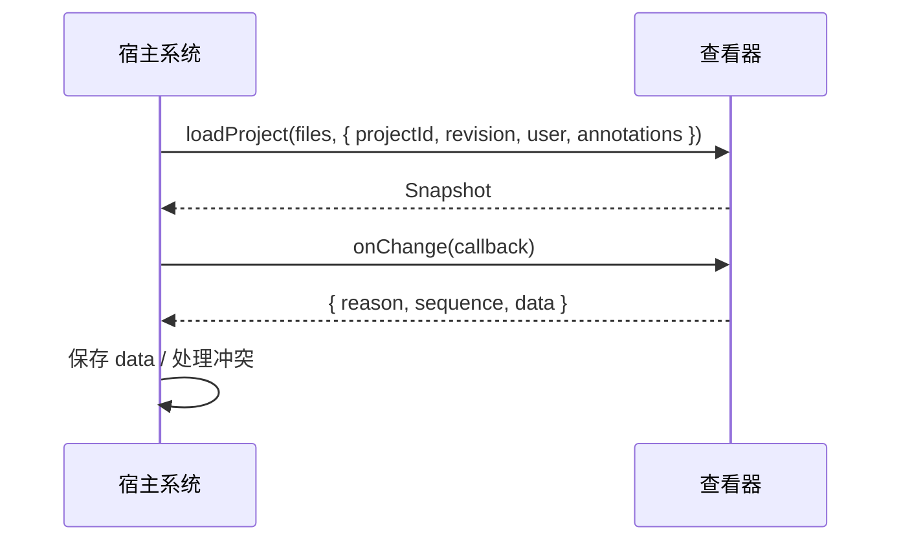

# EasyEDA Viewer 集成 API

适用于 `npm run build` 生成的 `dist/index.html`，批注接口版本 `1.2.0`，数据版本 `schemaVersion: 1`。

查看器负责**解析、渲染和批注交互**；宿主系统负责**提供文件、用户身份、权限和持久化**。
查看器不发起网络请求、不写回工程文件、不自动保存批注。

## 1. 可以集成到哪些系统

| 系统类型 | 典型用途 | 主要能力 |
| --- | --- | --- |
| 文档管理 / PLM / PDM | 在线预览工程并挂接评审批注 | `loadProject` + 批注 API + `onChange` 保存 |
| 评审 / 问题跟踪 | 在图纸上提问题、回复、跟踪状态 | 新建批注、回复、`pending/resolved`、定位 |
| BOM / 物料 / 生产 | 从 BOM 行定位到 PCB 或原理图元件 | `selectByDesignators` + `clearSelection` |
| 内网门户 / 知识库 | 只读预览，不展示批注入口 | `chrome.annotations:false` |
| 教学 / 演示页面 | 精简界面，只保留画布 | `?chrome=canvas` 或 `setChrome` |
| 自有 Web 前端 | 直接把查看器嵌进现有页面 | 源码引入 `createViewer` |

例如：评审系统在 `loadProject` 时传入已保存批注，用户操作通过 `onChange` 回存；BOM 系统加载 PCB 后调用 `selectByDesignators` 高亮物料位号；门户的只读预览设置 `annotations:false`。各场景的完整调用见后续章节。

两种接入方式：

1. **源码集成**：`const viewer = createViewer(host, options)`，批注 API 位于 `viewer.annotations`。
2. **独立页面 / iframe**：同源 iframe 通过 `iframe.contentWindow.easyedaViewer` 访问同一套批注 API。

跨域 iframe 不能直接调用 JS API。`postMessage` 仅覆盖加载、打开、适配、按位号选中、主题、语言和面板控制，不承载批注增删改。



## 2. 快速开始

```ts
import { createViewer } from './src/embed';

const viewer = createViewer(document.getElementById('host'), {
  lang: 'zh',
  theme: 'light',
});

const api = viewer.annotations;
await api.loadProject(files, {
  projectId: 'PROJECT-001',
  revision: 'R1',
  user: { id: 'user-123', name: '张三' }, // 传入后批注人只读
});

const unsubscribe = api.onChange(({ data }) => {
  // 交给宿主的保存队列；服务端确认后才算保存成功。
  void saveAnnotations(data);
});
```

在 `loadProject` 成功后再注册 `onChange`，可避免把初始批注恢复当作一次用户修改。

iframe 最小接入：

```js
const iframe = document.querySelector('#viewer');
await new Promise((resolve) => iframe.addEventListener('load', resolve, { once: true }));

const api = iframe.contentWindow.easyedaViewer;
if (!api || api.version !== '1.2.0') throw new Error('查看器 API 不可用或版本不匹配');

await api.loadProject(files, options);
api.onChange(({ data }) => saveAnnotations(data));
```

## 3. 加载工程

`loadProject(files, options)` 接收 `FileList` 或 `File[]`，返回 `Snapshot`。

- `.eprj3` 文件夹工程必须包含工程描述和全部图纸文件，保留相对路径。
- 也支持 `.epro2`、ZIP 工程包、`.elibz2` 库文件（预览其中的符号 / 封装）和单个 `.esch2` / `.epcb2` / `.epan2` / `.esym2` 文档。
- 同一时间只加载一个工程；加载、切图、批注修改不要并发调用。
- 源码集成也可用 `viewer.loadMap(path → Uint8Array)` 加载已读取的文件；批注场景建议用 `loadProject`，以便绑定工程 ID 和用户。

### 3.1 加载选项

| 字段 | 类型 | 默认 | 建议 |
| --- | --- | --- | --- |
| `projectId` | 非空字符串，≤500 字符 | 查看器生成本地标识 | 传宿主稳定的工程 ID |
| `revision` | 字符串，≤200 字符 | 空字符串 | 传工程版本或修订号 |
| `user` | `{ id, name }` | 保留当前用户 | 每次加载传当前登录用户 |
| `annotations` | `Snapshot` 或 JSON 字符串 | 不恢复 | 仅在宿主有已保存数据时传入 |

- 通过 `user` 或 `setUser` 设置用户后，批注人输入框锁定为**只读**并显示“只读”标记；未提供用户时使用本地默认用户，可手动修改。
- `projectId` 与 `revision` 用于绑定批注数据；导入时两者必须与加载时严格一致。
- 新工程加载会清空旧批注、选中态和撤销记录，加载前请保存旧工程数据。
- `loadProject` 返回 `Snapshot`；当前图纸信息用 `getContext()` 获取。

加载后检查：

```js
const { documents, currentDocument } = api.getContext();
// documents: 可批注图纸列表；currentDocument: 当前图纸或 null
await api.open(documents[0].nodeId);
```

## 4. 批注 API

### 4.1 数据结构

`Snapshot` 是当前工程全部批注的完整数据，`exportAnnotations()` 返回独立副本，不包含未提交草稿。

| Snapshot 字段 | 含义 |
| --- | --- |
| `schemaVersion` | 固定为 `1` |
| `projectId` / `revision` | 工程绑定信息 |
| `documents` | 可批注图纸 `Document[]` |
| `annotations` | 全部已提交批注 `Annotation[]` |

`Document`：`{ id, nodeId, group, title }`。`id` 是批注使用的稳定图纸标识；`nodeId` 仅供 `open()` 使用，工程树重建后可能变化。

`Annotation`：

| 字段 | 含义 |
| --- | --- |
| `id` | 唯一字符串 |
| `documentId` / `group` | 所属图纸；`group` 为 `schematic` 或 `pcb` |
| `type` | `text`、`rectangle`、`circle` |
| `geometry` | 图纸坐标，非屏幕像素 |
| `text` | 批注内容 |
| `creator` | `{ id, name }` |
| `createdAt` / `updatedAt` | ISO 时间字符串 |
| `status` | `pending` 或 `resolved` |
| `replies` | `Reply[]` |

`Reply`：`{ id, text, creator, createdAt }`。回复没有状态和更新时间。

坐标规则：`text` 使用 `{ x, y }`；`rectangle` / `circle` 使用 `{ x, y, width, height }`（左上角 + 尺寸，圆形宽高相等）。坐标由查看器生成，不要直接传鼠标 `clientX/clientY`。

### 4.2 接口表

| 接口 | 说明 |
| --- | --- |
| `version` | 接口版本，当前 `1.2.0` |
| `loadProject(files, options)` | 加载工程，可恢复批注 |
| `getContext()` | 读取工程、图纸列表和当前图纸 |
| `open(nodeId)` | 打开指定图纸（异步） |
| `setUser(user)` | 设置后续新增 / 回复的作者，并锁定批注人输入框 |
| `exportAnnotations()` | 导出完整 Snapshot 副本 |
| `importAnnotations(data)` | 校验后全量覆盖，返回导入数量 |
| `createAnnotation(input)` | 新建批注 |
| `updateAnnotation(id, patch)` | 修改文字或状态（不接受坐标） |
| `deleteAnnotation(id)` | 删除批注及其全部回复 |
| `addReply(id, text)` | 添加回复 |
| `focusAnnotation(id)` | 切换到所属图纸并居中定位（异步） |
| `undo()` / `redo()` | 撤销 / 重做，成功返回 `true` |
| `onChange(callback)` | 订阅数据变更，返回取消订阅函数 |
| `setAnnotationsVisible(value)` / `getAnnotationsVisible()` | 控制画布批注标记显隐 |
| `selectByDesignators(designators)` | 按位号批量选中并高亮 |
| `clearSelection()` | 取消全部选中 |
| `setLang('zh' \| 'en')` | 切换界面语言 |
| `setTheme('light' \| 'dark')` | 切换界面主题 |
| `setChrome(flags)` | 显示 / 隐藏工具栏和面板 |
| `fit()` | 当前图纸适配画布 |

除标注“异步”的方法外均为同步方法；同步方法可能抛异常。

### 4.3 常用示例

新建、回复、解决并定位：

```js
const doc = api.getContext().currentDocument;
if (!doc) throw new Error('请先打开原理图或 PCB');

const item = api.createAnnotation({
  documentId: doc.id,
  type: 'rectangle',
  geometry: { x: 100, y: 200, width: 80, height: 40 },
  text: '请检查此区域',
});
api.addReply(item.id, '已安排检查');
api.updateAnnotation(item.id, { status: 'resolved' });
await api.focusAnnotation(item.id);
```

导入 / 导出（全量覆盖，不合并）：

```js
try {
  const count = api.importAnnotations(savedJson);
  console.log('已导入', count, '条批注');
} catch (error) {
  console.error('导入失败，当前批注未改变', error.message);
}
```

数据约束（摘要）：

| 项目 | 限制 |
| --- | --- |
| 批注数量 | ≤10000 |
| 每条回复 | ≤1000 |
| 单段文字 | 非空，≤10000 字符 |
| 文字总量 | ≤10 MB |
| JSON 字符串 | ≤20 MB |
| ID / 用户名 | 非空，≤200 字符 |
| 记录 ID | 批注与回复之间全局唯一 |
| 坐标 | 有限数字，绝对值 ≤1e9；框宽高 >0；圆宽高相等 |

导入失败不会改动现有批注。未知字段不会保留；宿主自定义元数据请另存。

## 5. 按位号批量选中

```js
const matched = await api.selectByDesignators(['R12', 'C3', 'U1']);
if (!matched) console.log('当前图纸没有这些位号');
api.clearSelection();
```

- 按元件 `Designator` 精确匹配（忽略大小写和首尾空格）。
- 同一图纸上的全部命中同时高亮；第一个命中作为主选中项（属性面板、元件树）。
- 当前图纸有命中时不切页；当前图纸无命中时，原理图切到命中数最多的兄弟图页再高亮。
- 返回命中的不同位号数，`0` 表示未找到，不抛异常。
- 不影响批注数据。

iframe 消息：

```js
const frame = document.querySelector('#viewer');
frame.contentWindow.postMessage({ source: 'easyeda-viewer', cmd: 'select', designators: ['R12', 'C3'] }, '*');
frame.contentWindow.postMessage({ source: 'easyeda-viewer', cmd: 'select', designators: [] }, '*');
```

查看器回发 `select-result`：`{ designators, matched, ok }`。

## 6. 隐藏工具与面板

### 6.1 创建时控制

```ts
const viewer = createViewer(host, {
  chrome: {
    toolbar: true,
    left: true,
    right: true,
    status: true,
    annotations: false, // 隐藏批注工具栏按钮组与右栏批注页签
  },
});
```

| 字段 | 作用 |
| --- | --- |
| `toolbar` | 顶部工具栏 |
| `left` | 左侧文档树 / 元件树 |
| `right` | 右侧属性 / 图层 / 批注面板 |
| `status` | 底部状态栏 |
| `annotations` | 批注工具栏按钮组 + 右栏批注页签 + 画布批注交互 |

`annotations:false` 只隐藏批注界面，**批注数据 API 仍可用**，适合只读预览。
`left` / `right` 省略时按需自动显示；显式传 `true/false` 可固定。

### 6.2 运行时控制

```js
viewer.setChrome({ annotations: false });
viewer.setChrome({ left: false, right: false });
```

`setChrome` 只控制显示，不是权限控制。
定位批注等操作可能重新打开右侧面板。

### 6.3 URL 参数

| 参数 | 作用 |
| --- | --- |
| `?theme=light\|dark` | 界面主题，默认 `light` |
| `?lang=zh\|en` | 界面语言，默认 `zh` |
| `?toolbar=0` / `?left=0` / `?right=0` / `?status=0` | 单独隐藏对应区域 |
| `?annotations=0` | 隐藏批注工具栏与右栏批注页签 |
| `?chrome=canvas` | 隐藏全部界面，仅保留画布 |

关闭布尔参数也接受 `false` / `off`。

### 6.4 postMessage 控制

```js
const frame = document.querySelector('#viewer');
frame.contentWindow.postMessage({ source: 'easyeda-viewer', cmd: 'chrome', chrome: { annotations: false } }, '*');
frame.contentWindow.postMessage({ source: 'easyeda-viewer', cmd: 'lang', lang: 'en' }, '*');
frame.contentWindow.postMessage({ source: 'easyeda-viewer', cmd: 'theme', theme: 'dark' }, '*');
```

### 6.5 常见组合

| 目标 | 配置 |
| --- | --- |
| 只读预览（保留工程浏览） | `chrome: { annotations:false }` 或 `?annotations=0` |
| 只留画布 / 投屏 | `?chrome=canvas` |
| 教学页（无左栏，保留工具栏） | `chrome: { left:false, annotations:false }` |
| 全功能评审 | 默认配置 |

批注**标记**的显隐另用 `setAnnotationsVisible(false)`：隐藏画布标记，但右栏记录仍可查看，数据不变。

## 7. 事件与保存

```js
const pending = [];
const unsubscribe = api.onChange(({ reason, sequence, data }) => {
  pending.push(data);
});
```

| 字段 | 含义 |
| --- | --- |
| `reason` | `create` / `update` / `reply` / `delete` / `import` / `undo` / `redo` |
| `sequence` | 当前实例的递增序号，仅用于排序，不是服务端版本号 |
| `data` | 最新完整 Snapshot 副本 |

- 通知在数据提交后同步发出；查看器不等待宿主保存。
- 绘制、拖动、取消、选中、切图、显隐不触发 `onChange`。
- 不要在回调中再次修改数据或加载工程；需要时先退出回调再操作。
- 多用户冲突、幂等、鉴权由宿主服务端处理。

保存队列建议：串行发送，服务端确认后再出队；失败保留队首并显示重试入口；切换工程或卸载 iframe 前 `await flush()`。

### 7.1 window 事件

| 事件 | detail | 时机 |
| --- | --- | --- |
| `easyeda-annotations-ready` | `{ version }` | API 初始化完成 |
| `easyeda-annotations-context` | Snapshot | 工程模型就绪、批注恢复前 |
| `easyeda-annotations-change` | `{ reason, sequence, data }` | 与 `onChange` 同步 |
| `easyeda-viewer-load-error` | `{ message }` | 加载或打开失败 |

`easyeda-annotations-ready` 由独立页面入口发送；源码集成直接使用 `createViewer` 返回的 `viewer.annotations`。
iframe `load` 可能晚于 `ready`，直接检查 `easyedaViewer` 是否存在即可。
批注恢复完成的信号是 `await loadProject(...)` 返回，不是 `context` 事件。

### 7.2 postMessage 命令

消息统一带 `source: 'easyeda-viewer'`，由宿主发往 `iframe.contentWindow`；查看器通过 `window.parent.postMessage` 回发事件。

| cmd | 参数 | 回发 |
| --- | --- | --- |
| `load` | `files: [{ name, dataBase64 }]` | `load-ok { count }` 或 `error` |
| `open` | `nodeId` | `open-result { nodeId, ok }` |
| `fit` | 无 | 无 |
| `select` | `designators: string[]` | `select-result { designators, matched, ok }` |
| `theme` | `theme: 'light' \| 'dark'` | 无 |
| `lang` | `lang: 'zh' \| 'en'` | 无 |
| `chrome` | `chrome: { toolbar, left, right, status, annotations }` | 无 |

`postMessage` 不提供批注增删改；需要批注 API 时请使用同源 JS 访问。

## 8. 语言与主题

```js
api.setLang('en');
api.setTheme('dark');
```

- 批注界面、工具栏、面板、错误提示均支持中 / 英文，随 `setLang`、`?lang` 或工具栏语言按钮实时切换。
- 默认批注人（`本地用户` / `Local user`）仅在用户未改名时跟随语言。
- 由 `loadProject.user` 或 `setUser` 提供的批注人只读，不随语言切换改名。
- 主题只影响界面外壳；画布图元颜色始终遵循源文件。

## 9. 错误与草稿

错误消息用于提示，不保证稳定错误码，不要把文案当作业务分支条件。

| 情况 | 结果 | 宿主处理 |
| --- | --- | --- |
| 空文件列表 / 并发加载 | `loadProject` 拒绝 | 等待上一次加载结束 |
| 工程已加载但批注恢复失败 | `loadProject` 拒绝，工程可能已切换 | 保留服务端备份，不要自动保存空数据 |
| 工程或版本不匹配 | 导入抛错，旧批注不变 | 检查 `projectId` / `revision` |
| 图纸 ID 不存在 | 新增 / 导入抛错 | 使用当前 `documents` 中的 `id` |
| 批注 ID 不存在 | 修改 / 回复 / 删除 / 定位抛错 | 刷新记录引用 |
| `open` 节点不存在 | Promise 拒绝 | 重新读取 `nodeId` |
| 网络保存失败 | 查看器内存数据仍在 | 宿主保留待保存状态并重试 |

草稿保护：存在未保存的绘图 / 编辑草稿时，切图、定位、导入、重载、撤销、隐藏和编辑其他批注都会被拒绝；先保存或取消。Esc 或“取消”会明确丢弃草稿。

## 10. 安全与部署

- 查看器没有权限系统；批注人名称（即使界面锁定为只读）来自客户端输入，**不能作为审计依据**。宿主应在服务端按登录身份鉴权并记录审计信息。
- `projectId` / `revision` 匹配不是认证；宿主必须校验用户对工程的读写权限。
- 批注内容按纯文本渲染，不执行 HTML；宿主仍需做输入检查和存储限制。
- 只允许可信同源页面访问 `window.easyedaViewer`；不要依赖 `window.__ev`。
- 跨域嵌入请使用 `postMessage` 的有限命令，或把查看器部署到与宿主同源的路径。
- CSP、sandbox、iframe 策略由宿主安全负责人确认；需允许内联脚本与样式。

## 11. 集成检查清单

1. 同源 iframe 或源码集成可正常初始化，`api.version === '1.2.0'`。
2. 工程加载后 `getContext().documents` 与 `currentDocument` 正确。
3. 传入稳定的 `projectId` / `revision` / `user`。
4. 新建、回复、解决、删除、撤销 / 重做均只触发一次保存通知。
5. 导出后可原样导入恢复，错误工程数据被拒绝且旧数据不变。
6. 切换工程时批注不串用，旧工程数据已保存。
7. `selectByDesignators` 能命中并高亮，`clearSelection` 能取消。
8. 只读场景确认批注 UI 已隐藏且 API 仍可用。
9. 刷新 iframe 后重新加载并恢复数据。
10. 模拟保存失败与并发保存，宿主显示未保存状态并提供重试。

仓库内自动化用例：`qa/annotations/`（冒烟、对抗、同源 iframe、边界、滚轮对齐）。
这些用例不等同于宿主系统的认证、CSP、后端保存和多用户冲突验收。
